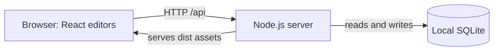

# Commonplace

[](https://github.com/Mohammed-Moniem/commonplace/actions/workflows/ci.yml)

A local workspace for documents, spreadsheets, and presentations. Choose **Docs**, **Sheets**, or **Slides** from one home screen; each editor opens in its own browser tab.

The complete **React frontend** and **Node.js backend** are in this repository. **SQLite** stores your work on your computer. No Google account, API key, external database, Docker installation, or cloud subscription is required.

This independent application is not affiliated with Google and does not reproduce every Google Workspace or Microsoft Office capability. Sharing, accounts, and credential-dependent integrations are outside its scope.

## Contents

- [Requirements](#requirements)
- [Set up on another computer](#set-up-on-another-computer)
- [Starting and stopping](#starting-and-stopping)
- [Frontend and backend](#frontend-and-backend)
- [Development](#development)
- [Configuration](#configuration)
- [Move your workspace to another machine](#move-your-workspace-to-another-machine)
- [Backups and updates](#backups-and-updates)
- [Tests and packaging](#tests-and-packaging)
- [Features and limits](#features-and-limits)
- [Troubleshooting](#troubleshooting)

## Requirements

| Requirement | Details |
| --- | --- |
| Node.js | **24.x recommended**, matching CI. Node 24 or newer is required because the backend uses built-in `node:sqlite`. |
| npm | Included with the normal Node.js installation. |
| Git | Used for cloning and updating. Download ZIP also works for a one-time copy. |
| Browser | A current desktop Chrome, Edge, Firefox, or Safari. Allow editor tabs to open. |
| OS | macOS, Linux, or Windows with a supported Node installation. Consult CI's actual results for verified platform status. |

Install Node from the [official downloads page](https://nodejs.org/en/download), selecting **24.x** and your OS/CPU. Install Git from [git-scm.com](https://git-scm.com/downloads/). Reopen your terminal and check:

```sh
node --version
npm --version
git --version
```

You do **not** need to install SQLite separately, create a database manually, or install Python/C++ tools for a database driver. Keep development dependencies installed for building/testing; do not use `--omit=dev` before building.

## Set up on another computer

### macOS or Linux

Open Terminal in a folder where you keep projects:

```sh
git clone https://github.com/Mohammed-Moniem/commonplace.git
cd commonplace
npm ci --ignore-scripts
npm run build
npm start
```

Keep that terminal open. When it prints `Commonplace is ready at http://127.0.0.1:4174`, open **http://127.0.0.1:4174/**.

### Windows PowerShell

Install Node and Git, reopen PowerShell, then run:

```powershell
git clone https://github.com/Mohammed-Moniem/commonplace.git
Set-Location commonplace
npm.cmd ci --ignore-scripts
npm.cmd run build
npm.cmd start
```

Open **http://127.0.0.1:4174/**. `npm.cmd` avoids environments that block the `npm.ps1` PowerShell shim; it uses the same npm installation without changing execution policy.

### What setup does

1. Clones both frontend and backend source.
2. Installs the exact dependencies from `package-lock.json`.
3. Compiles React into `dist/`.
4. Starts Node, serves the frontend/API together, and creates the local SQLite database and schema automatically.

First launch includes example files. Your existing personal workspace is **not** downloaded from GitHub; use the migration instructions below.

There is one dependency installation at the repository root. There are no separate frontend/backend installation steps, no required `.env` file, and no credentials to configure.

### Without Git

Choose **Code → Download ZIP** on GitHub, extract it, open a terminal inside the folder containing `package.json`, and run the three npm commands above. GitHub's source ZIP contains neither installed dependencies nor a compiled frontend, so both installation and building are required. Download a new ZIP to update this kind of copy.

## Starting and stopping

After initial setup, ordinary use only needs:

```sh
cd commonplace
npm start
```

Use `npm.cmd start` in PowerShell. Keep the terminal open while using the app; **Ctrl+C** stops it. Saved work remains in SQLite. Run the same command to restart. No rebuild is needed until frontend source changes. No operating-system background service is installed automatically.

Open **http://127.0.0.1:4174/api/health** to check the backend. It should report `ok: true`, `storage: "sqlite"`, and the app version. Use your chosen port if you changed `PORT`.

## Frontend and backend



Normal operation uses **one Node process and one port, 4174**, for both the compiled React frontend and backend API. No separate frontend production server or CORS configuration is needed.

| Path | Purpose |
| --- | --- |
| `src/` | React home screen, shared components, editors, and styles. |
| `src/editors/` | Docs, Sheets, and Slides implementations. |
| `src/lib/` | Formula engine, spreadsheet operations, templates, clipboard/import helpers. |
| `server/index.js` | Node HTTP server, API routes, same-origin write checks, static assets. |
| `server/store.js` | SQLite schema, files/templates/history/comments, validation and transactions. |
| `server/featureValidation.js` | Validation for advanced editor content. |
| `public/` | Static frontend assets. |
| `tests/` | Regression, editor, API, persistence, and Office-format assertions. |
| `scripts/` | Benchmarks, packaging and verification. The development launcher is `server/dev.js`. |
| `docs/` | Feature plans and acceptance contracts. |
| `evidence/benchmark-v2/` | Audited synthetic benchmark inputs and immutable 0.1 baseline. |
| `dist/` | Generated frontend build; ignored by Git. |
| `data/` | Your SQLite workspace and local backups; ignored by Git. |

The client uses native `fetch`. Docs uses Tiptap/ProseMirror, Sheets a custom grid and interpreted formula engine, and Slides a custom SVG-backed editor. Office readers/writers run locally. `"private": true` in `package.json` prevents accidental npm publication; it does not make this GitHub repository private.

## Development

Stop production first, then run from the project root:

```sh
npm ci --ignore-scripts
npm run dev
```

Use `npm.cmd` for npm commands in PowerShell.

- Frontend with hot reload: **http://127.0.0.1:5174/**
- Backend: **http://127.0.0.1:4174/api/health**
- Vite proxies `/api` from 5174 to 4174; the launcher starts both processes.
- Ctrl+C stops both. Development uses the same default database as production; set a separate `COMMONPLACE_DB` for isolated development.
- Keep `PORT` unset or `4174` in development. The API proxy in `vite.config.js` is currently fixed at 4174. Production supports another port without editing Vite.
- Vite requires port 5174 to be free rather than silently selecting another port.

## Configuration

Normal use needs no configuration. Optional variables are read from the process environment. **A `.env` file is not loaded automatically.**

| Variable | Default | Purpose |
| --- | --- | --- |
| `PORT` | `4174` | Production HTTP port; keep 4174 for the current dev proxy. |
| `COMMONPLACE_DB` | Project-root `data/commonplace.sqlite` | SQLite file; parent directories are created and must be writable. |
| `COMMONPLACE_DIST` | Project-root `dist/` | Compiled frontend directory served by Node. |
| `COMMONPLACE_PACKAGE_DIST` | `dist/` | Build directory included by packaging; packaging only. |

Use absolute paths for overrides. Relative overrides resolve from the directory where you launch the command.

**Another production port on macOS/Linux:**

```sh
PORT=4180 npm start
```

**PowerShell:**

```powershell
$env:PORT = "4180"
npm.cmd start
```

Open http://127.0.0.1:4180/. After stopping, `Remove-Item Env:PORT` clears the PowerShell override.

**Custom database — replace these examples with a writable path you own:**

```sh
COMMONPLACE_DB="/absolute/path/to/commonplace-data/workspace.sqlite" npm start
```

```powershell
$env:COMMONPLACE_DB = "C:\CommonplaceData\workspace.sqlite"
npm.cmd start
```

Use one running server per database. Keep the database outside `dist/` and avoid an actively synchronized cloud/network folder for the live SQLite file.

## Move your workspace to another machine

GitHub transfers application source, **not your personal documents**. Choose one method.

### Option A: export/import a backup

1. On the old computer, wait until editors say **All changes saved**.
2. On Home choose **Export backup**, then retain the downloaded JSON file.
3. Transfer that file privately to the other computer.
4. Install/start Commonplace there using the instructions above.
5. Choose **Import** on its Home screen, select the backup, and verify your files.

Backups include files, folders, comments, retained history, and saved templates. Import **appends with new identifiers**, remaps local linked spreadsheet sources, and preserves existing files. It does not replace the whole destination database. Example files remain, and importing the same backup twice creates another set of copies.

Requests are limited to **18 MB**, and one stored file's content to **15 MB**. Use Option B for larger workspaces.

### Option B: copy the stopped database for an exact workspace

1. Wait for saved status and stop Commonplace with Ctrl+C on **both** computers.
2. Back up the destination's existing data directory before replacing anything.
3. Copy the old installation's complete `data/` folder into the new installation, retaining `commonplace.sqlite`.
4. If you configured `COMMONPLACE_DB`, copy that database and any same-named `-wal`/`-shm` sidecars instead, then set the destination path accordingly.
5. Start the destination app and verify the workspace.

This preserves identifiers, links, templates, comments, and history exactly. Copy **after stopping**; copying only a running main SQLite file can miss recent WAL writes. Do not overwrite a running database or merge SQLite files manually.

Install dependencies and build on the destination machine. Do not copy `node_modules/` between operating systems or CPU architectures.

## Backups and updates

- Export workspace backups regularly and keep a copy separately from the machine.
- Before upgrades or exact database replacement, stop the server and copy the complete data directory to a dated backup location.
- Do not delete `data/` to troubleshoot installation problems.
- Unsaved drafts live in each browser tab's session storage. They are not moved by Git, JSON workspace export, or copying SQLite. Save before migration.
- Save conflicts and failed saves have recovery dialogs/downloads. Check them before closing the affected tab.
- To restore an exact database backup, stop the server, back up current data, then replace it with the chosen stopped backup. JSON import appends instead of destructively restoring.

To update a Git installation, wait for saved status, stop the server, and back up the database, then run:

```sh
git pull --ff-only
npm ci --ignore-scripts
npm run build
npm start
```

Use `npm.cmd` in PowerShell. `--ff-only` avoids inventing a merge over local source changes. If Git refuses the update, preserve your changes and resolve that separately; do not hard-reset or delete your database as a setup step.

Git pulls leave the ignored `data/` directory local. Use the same database path when restarting. Refresh editor tabs after their changes are saved to load the new frontend. Keep backups before upgrades or attempting to run an older version against newer data.

## Tests and packaging

After installing dependencies, run commands from the repository root:

| Command | Purpose |
| --- | --- |
| `npm test` | Full regression suite, including API save/history/backup/reopen. |
| `npm run build` | Compile React into `dist/`. |
| `npm run check` | Test, then build. |
| `npm run benchmark` | Same-fixture comparisons against the included immutable 0.1 baseline, plus current regressions. |
| `npm run benchmark:cells` | Focused daily-cell contracts. |
| `npm run benchmark:features` | All 60 additions plus shared template/linked-data contracts and full regression. |
| `node scripts/verify.mjs` | Tests, isolated build, JavaScript syntax checks, packaging, then actual extracted-server launch/restart persistence. |
| `npm run package` | Create `commonplace-<version>.zip` from the existing `dist/`; build first. |

Tests and the verifier use isolated storage. The verifier builds into `.bench-build` so it does not replace a running `dist`. Ordinary `npm run build` and `npm run check` replace `dist`; stop production before rebuilding an installation you are actively using.

Distribution ZIPs include source, lockfile, compiled frontend, tests, docs, and audited benchmark inputs. They exclude personal data, installed dependencies, credentials, browser captures, and private machine receipts. With Node 24 installed, a built distribution can run using `npm start` without reinstalling frontend dependencies; install dependencies if rebuilding or testing.

Fresh reports bind the source actually tested and stay under ignored `evidence/` directories. Historical private captures are not published. The [CI workflow](.github/workflows/ci.yml) runs benchmarks and extracted-package verification on **Ubuntu, macOS, and Windows with Node 24**. Consult [actual Actions results](https://github.com/Mohammed-Moniem/commonplace/actions) for current platform verification.

See [BENCHMARK.md](BENCHMARK.md) for reproducible inputs and limits. Some optional provenance/capture helpers in `scripts/` require the original untracked development captures; they are not part of normal setup or the commands above.

## Features and limits

| Area | Capabilities |
| --- | --- |
| Workspace | Launcher, folders/search/favorites, copies/trash, built-in and saved templates, import/export and workspace backup. |
| Saving | SQLite autosave, draft recovery, concurrent-save conflicts, named versions/restore and local comments. |
| Docs | Rich text/tables, nested/duplicate tabs, suggestions, footnotes/TOC, citations/bibliography, bookmarks/equations/columns, image crop/rotate/replace/wrap, painter, paragraph design, regex/all-tab search, DOCX/HTML/Markdown/text and browser print. |
| Sheets | Grid/clipboard/fill/dates, formula catalog and references, names/spills/merges, filters/views/sort, checkbox and formula validation/rules, cleanup/split/duplicates, notes/links/transpose/freeze, charts/pivots, CSV/TSV/JSON/XLSX. |
| Slides | Rich word/list/paragraph editing, shapes/images/tables/charts/media, groups/transforms/clipboard, crop/masks/painter/guides/connectors/locks/links, hidden slides/sections/footer, presenter tools, PNG/SVG/PPTX/HTML/JSON and deck append. |
| Linked data | Insert saved local Sheets ranges or column/line/pie charts into Docs/Slides, then explicitly refresh through More → Update linked data. Cached content remains readable if a source is unavailable. |

The [60-feature plan](docs/FEATURES-60.md) lists 20 additions per editor, ranked by impact/effort. Existing capabilities are not counted twice.

Office readers/writers preserve common content, not every external structure. Retain imported originals. PPTX media uses placeholders and animation steps flatten with warnings; interactive HTML retains local playback. Citations use a simple APA/MLA/Chicago-style subset. Equations use a bounded grammar and export editable source text to Word. Pagination is approximate. Some spreadsheet annotations/views use Commonplace metadata rather than native Excel controls; partial formula-range moves reject atomically. Full formula/chart/pivot/master/animation, external Office rendering, and accessibility parity remain incomplete.

The server binds to **127.0.0.1** and checks local Host headers. A different device cannot use your computer's `127.0.0.1`: install the app there and migrate your workspace. Public/LAN hosting, authentication, TLS, access roles, and multi-user operation are not configured. GitHub hosts this source; GitHub Pages cannot run its Node/SQLite backend.

Core editing works offline after installation/build. Optional Google Fonts CSS may make an external request and has system-font fallbacks. There are no required API keys or cloud services.

## Troubleshooting

| Symptom | Resolution |
| --- | --- |
| Commands not found | Install Node/Git, reopen the terminal, check versions. |
| `node:sqlite` missing | Select Node 24 in the same terminal used to launch. |
| `npm.ps1` blocked | Use `npm.cmd`; no PowerShell policy change is needed. |
| Site unreachable | Leave the server running; check terminal errors, port, and `/api/health`. |
| API works but frontend missing | Build from the project root; check `COMMONPLACE_DIST`. |
| `EADDRINUSE` on 4174 | Stop the other copy you started or choose another production `PORT`. |
| Vite 5174 is busy | Stop the prior dev process; its port is intentionally strict. |
| Dev API/saves fail | Use frontend5174/backend4174; clear custom `PORT` or deliberately update Vite's proxy. |
| Registry/proxy installation failure | Fix access to the npm registry, retain the lockfile, retry `npm ci --ignore-scripts`. |
| SQLite cannot open/write or is busy | Use a writable local path and one server per database; check custom paths and cloud sync. |
| Workspace missing on a new machine | Import a backup/copy stopped data; Git does not contain your files. Check `COMMONPLACE_DB`. |
| Large backup cannot import | Use stopped-database transfer for workspaces exceeding the request limit. |
| Editor does not open | Allow local pop-ups/tabs or use the fallback open link. |
| Presenter media does not autoplay | Click Play in the audience window as required by browser policy. |
| Fonts differ offline | System-font fallback is expected. |
| Old UI after updating | Wait for saved status, refresh editor tabs after rebuild/restart. |

Personal databases, backups, workspace exports, credentials, browser captures, and local development provenance are excluded from this public repository.
